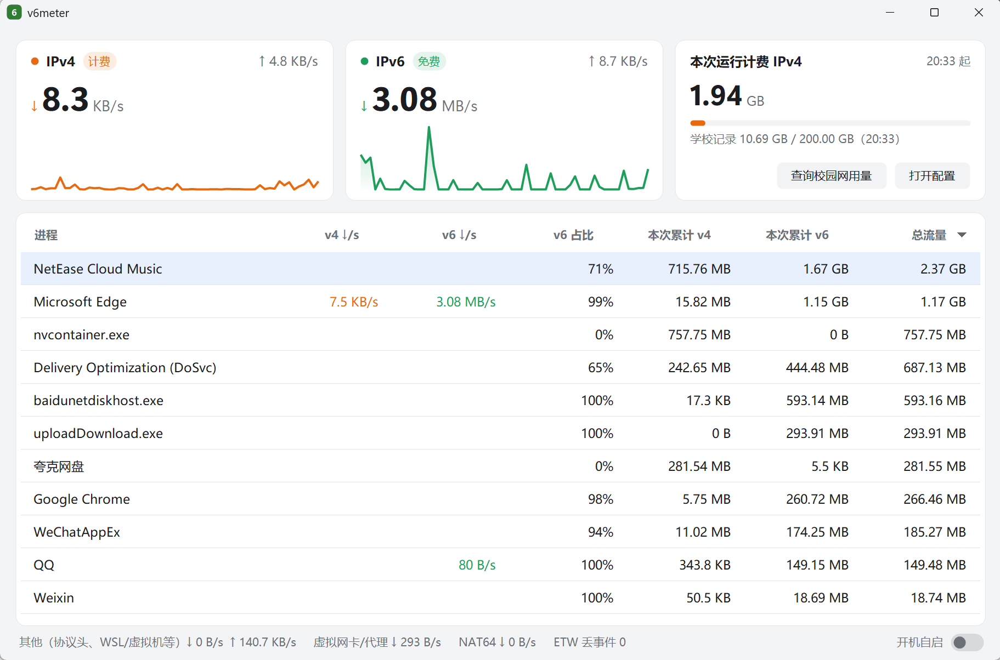
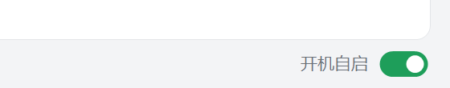
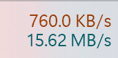
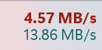
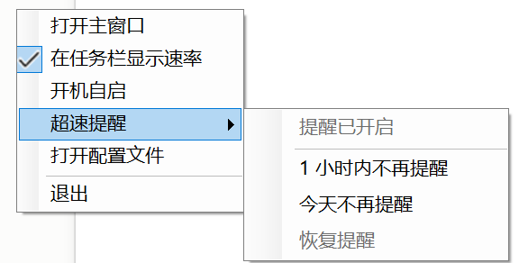
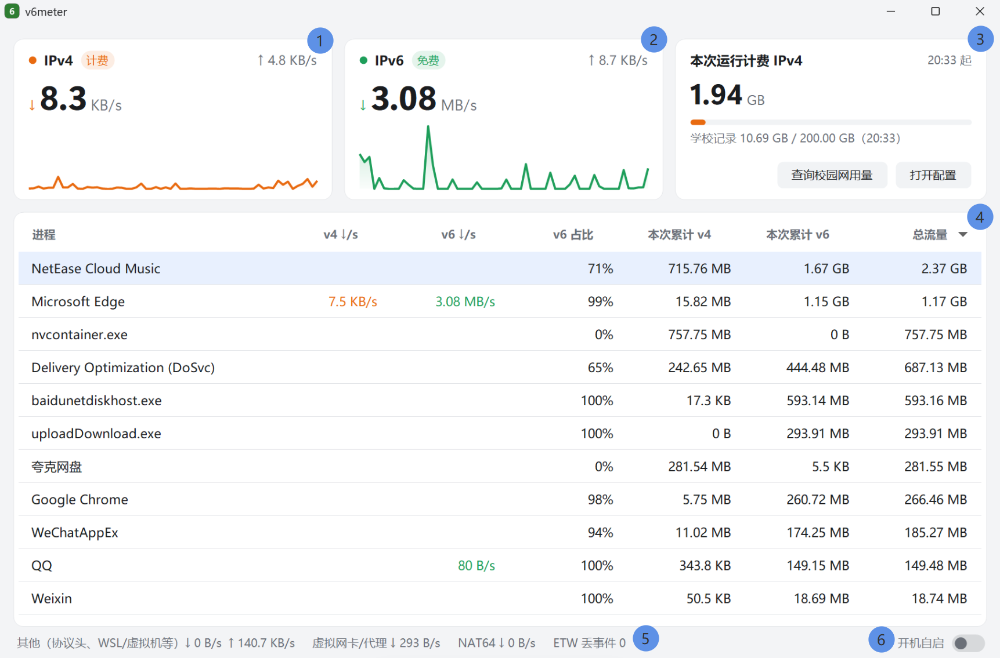
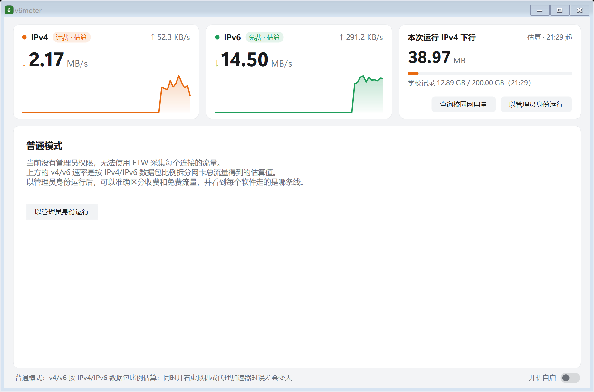
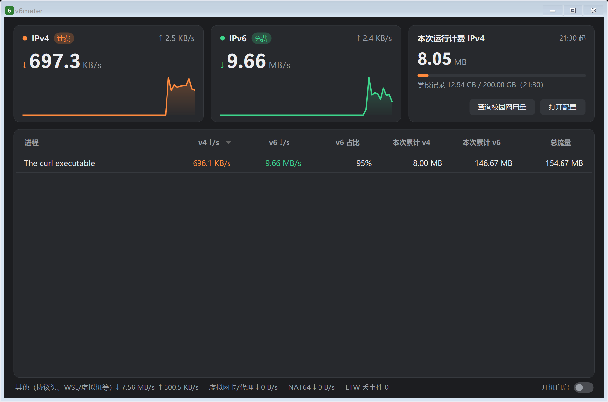
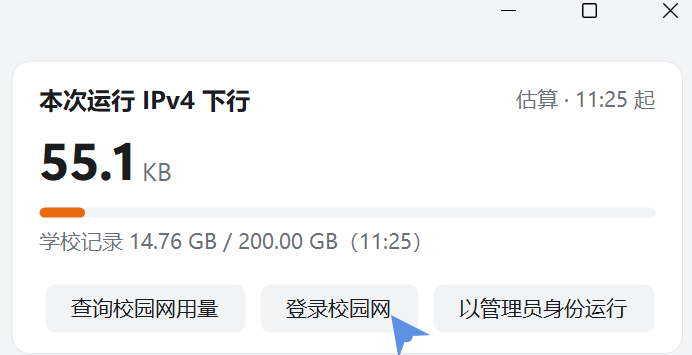
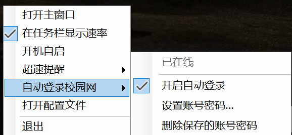

# v6meter：看清你的流量走的是哪条路

> 合肥工业大学宣城校区校园网流量小助手（Windows 10 / 11）

<p align="center">
  
</p>

这个软件是为这篇帖子做的：[关于校园网的教育网线路与 Steam 免流量下载指南](https://tieba.baidu.com/p/11089694940)。

## 【一、为什么需要这个软件】

帖子里说过，我们的校园网其实有两条路线：

① **IPv4**：学校买的商用出口（宿舍楼是联通），就是平时弹出登录认证页面的那个"校园网"。每天限 30G、每月 200G、晚上断网，都是针对它的，它的上行是不计费的，只有下行计费，但下行到限额之后上行同样会断。

② **IPv6**：教育网 CERNET2，**完全免费、不限流量**。目前只有宿舍楼的**有线网络**能拿到。

问题是，你下东西的时候，电脑并不会告诉你它走的是哪条路。百度网盘、夸克、Steam、浏览器、Windows 更新……有的走免费的 IPv6，有的走收费的 IPv4，有的两条都走。流量用超了，却不知道是谁用掉的。

**v6meter 就是干这个的**：它常驻在任务栏上，实时告诉你此刻有多少流量走的是收费的 IPv4，有多少走的是免费的 IPv6，还能告诉你具体是哪个软件在用收费流量。比如你照帖子用 UsbEAm 下 Steam 游戏，开着 v6meter 就能直接看到流量是不是真的走了 IPv6。

它能做的事：

- **一眼看到速度**：任务栏右下角一直显示 IPv4 和 IPv6 的下载速度。
- **揪出"偷跑"流量的软件**：列出每个软件在两条路上各用了多少。
- **超速提醒**：收费的 IPv4 一直在高速下载时，弹通知告诉你是哪个软件。
- **学校账户用量**：一打开就自动查校园网自助系统里本月用了多少（已经帮你乘 2 换算成实际用量，原因见第六部分）。

它**只看不改**：不会改你的网络设置，不会限速，也不会把任何数据传到网上。

## 【二、下载和打开】

① 到 [Releases 页面](https://github.com/chyxiong/v6meter/releases) 下载 `v6meter.exe`（约 120 MB，实际使用时常驻内存约 20 MB）。

② 新建一个文件夹专门放它，比如 `D:\v6meter\`，把 exe 放进去。这个软件是免安装的，也不用另外装什么运行库，直接双击就能用。设置文件会保存在同一个文件夹里，所以别放在桌面或"下载"文件夹里随手删了。

③ 双击打开。这里 Windows 可能会弹"Windows 已保护你的电脑"，点击【更多信息】->【仍要运行】就行。弹这个是因为软件没有花钱买微软的签名证书，Windows 不认识它，不是查出了病毒。

### 两种打开方式

| 打开方式 | 能看到什么 | 适合谁 |
|---|---|---|
| 直接双击（**普通模式**） | IPv4 / IPv6 的速度，但只是**估算值**；看不到是哪个软件 | 只想大概看一眼 |
| 右键 ->【以管理员身份运行】（**完整模式**） | 全部功能：**准确**区分收费和免费流量、每个软件的用量、超速提醒 | 推荐大部分同学用这个 |

**为什么完整模式要管理员权限？** 要知道"哪个软件的哪份数据走了哪条路"，得读取 Windows 记录的网络连接信息，而 Windows 规定只有管理员才能读。v6meter 只是读，不会改你电脑上的任何设置。

普通模式下也可以随时点主窗口里的【以管理员身份运行】切过去。

### 开机自动启动（推荐打开）

每次都右键【以管理员身份运行】太麻烦的话，把开机自启打开就行：点主窗口右下角的【开机自启】开关，或者右键菜单里的【开机自启】。

<p align="center">
  
</p>

- 如果弹出"你要允许此应用对你的设备进行更改吗？"，点【是】。只有打开、关闭这个开关的时候会问，之后每次开机都不会再问。
- 打开以后，每次开机登录大约 10 秒，v6meter 会**自动以完整模式启动**。
- 如果你的 Windows 账户不是管理员（比如公用电脑），自动启动的是普通模式。
- 以后把 v6meter 挪到别的文件夹了，再把开关打开一次就行，v6meter 发现位置变了也会提醒你。

## 【三、看懂任务栏上的数字】

打开后，任务栏右下角时钟左边会多出两行小字。

| 平时 | IPv4 下载太快时 |
|---|---|
|  |  |

- **上面一行（橙色）**：IPv4 下载速度，也就是**收费**流量。
- **下面一行（青色）**：IPv6 下载速度，也就是**免费**流量。
- 收费的 IPv4 速度超过提醒值（默认每秒 5 MB）的时候，上面一行会**变成红色加粗**。

单击这两行字打开主窗口，右键打开菜单。全屏看视频、打游戏的时候它会自动隐藏。

> 不想在任务栏显示？右键 -> 取消勾选【在任务栏显示速率】。

### 右键菜单

右键任务栏上的速度数字，或者右键右下角托盘里的"6"图标，都能打开这个菜单：

<p align="center">
  
</p>

- 【打开主窗口】：和单击一样。
- 【在任务栏显示速率】：打勾时任务栏上显示那两行速度，取消就不显示。
- 【开机自启】：见第二部分。
- 【超速提醒】：收费流量下得太快时弹的通知太烦的话，可以在这里选【1 小时内不再提醒】或者【今天不再提醒】，想恢复就点【恢复提醒】。最上面一行灰字显示现在的状态。直接点一下弹出来的超速通知，也能选暂停。
  - 暂停期间只是不弹通知，任务栏上那一行超速时照样会变红。
  - 选了【今天不再提醒】的话，当天重启电脑也不会再提醒，第二天自动恢复。
- 【自动登录校园网】：开机、连上网、掉线以后自动帮你登录校园网，不用再去网页上点登录。见第六部分。
- 【打开配置文件】：用记事本打开设置，见第七部分。
- 【以管理员身份运行（显示进程、区分收费流量）】：只在普通模式下出现，点了会切到完整模式。
- 【退出】：关掉 v6meter。

## 【四、看懂主窗口】

单击任务栏上的数字，或者单击右下角托盘里的绿色"6"图标，就能打开主窗口：

<p align="center">
  
</p>

**① IPv4（下行计费）**：此刻 IPv4 的下载速度（大字）和上传速度（右上角小字），下面的曲线是最近一分钟的变化。

**② IPv6（免费）**：同上，只不过是免费的 IPv6。我们希望大部分流量都在这边。

**③ 本次运行计费 IPv4**：大字是这次打开 v6meter 以来一共统计到了多少计费流量，关掉 v6meter 就清零。
- 下面一行小字是**学校记录的本月用量**（打开时自动查，见第六部分）。在设置里填了每月限额的话，还会显示进度条，用到 80% 变黄，95% 变红。没连校园网、查不到的时候，这一行不显示。
- 【查询校园网用量】：重新查一次，弹窗显示学校记录的详细信息。
- 【登录校园网】：用保存的学号和密码马上登录一次（第一次点会让你填），不用再打开浏览器。见第六部分。
- 窗口拉得比较窄时，这几个按钮会自动换成"查询用量 / 登录 / 配置"这样的短名字。
- 【打开配置】：修改设置（见第七部分）。

**④ 每个软件的用量**：这张表是最有用的部分。
- **v4 ↓/s、v6 ↓/s**：这个软件此刻在两条路上的下载速度。
- **v6 占比**：这个软件的流量有多少走了免费的 IPv6。
- **本次累计 v4、本次累计 v6、总流量**：打开 v6meter 以来，这个软件在两条路上各下了多少，以及加起来一共多少。
- 默认按 IPv4 下载速度从高到低排，正在用收费流量的软件总在最上面。点表头可以换排序。
- 只列出总流量超过 10 MB 的软件，最多 20 个；超过 20 个时，总流量最少的先被挤掉。

截图里，网易云音乐 71% 的流量走的是免费的 IPv6，但也用掉了 715 MB 收费流量；nvcontainer.exe（NVIDIA 的后台程序）757 MB 全走的收费 IPv4。

**⑤ 底部一行**：辅助信息，一般不用管。
- **其他**：网卡收到了、但没法算到具体软件头上的流量，比如每个数据包外面的"信封"（协议头）、网不好时重复发的数据、虚拟机里的流量。一般占总量的百分之几到十几。这个数每秒都在跳，偶尔变大一下不用在意。
- **虚拟网卡/代理**：开了加速器、VPN、代理（魔法）时可能会有数字，见第八部分。
- **ETW 丢事件**：正常是 0。不是 0 说明电脑太忙，有少量记录没来得及统计，会标黄。如果这里变成黄色的"ETW 监控会话已停止，正在重新建立"，说明监控被别的程序停掉了，v6meter 会每 5 秒自动重试。

**⑥ 开机自启**：见第二部分。

### 普通模式下的主窗口

直接双击打开时是这样的：只有估算的速度，没有软件列表。点【以管理员身份运行】就能切到完整模式。

<p align="center">
  
</p>

### 深色模式

Windows 设成深色模式的话，v6meter 会自动跟着变深色：

<p align="center">
  
</p>

## 【五、我的 v6 速度为什么一直是 0？】

先按帖子第二部分确认你有没有 IPv6（看 IPv6 地址是不是 240c 开头）。常见原因：

- **用的是 Wi-Fi，或者不在宿舍**：教育网 IPv6 目前只有宿舍楼的有线网络能拿到。
- **系统里把 IPv6 关掉了**：帖子里有重新打开的步骤。
- **你在用的软件本身不支持 IPv6**：比如 Github 这类国外网站，只能走 IPv4。Steam 默认也走 IPv4，可以照帖子用 UsbEAm 切到 IPv6。

## 【六、查询学校账户里的用量】

**每次打开 v6meter 都会自动查一次**，结果显示在主窗口右上角那张卡片里。刚开机时网络可能还没连好，查不到的话它会在 30 秒和 2 分钟后再各试一次。之后每小时自动再查一次；一直没查到时，连上网络后也会马上补查。

想看详细信息，或者想刷新一下，点【查询校园网用量】，会弹出学校自助服务系统里记录的使用时长、已用流量和账户余额。

有两点要特别注意：

① **学校系统显示的流量只有实际用量的一半。** 比如系统里显示用了 285.922 MB，实际用了 571.844 MB。所以每月限额 200G 的话，学校系统显示到 100G 时，你其实就已经用满了。v6meter 已经帮你**自动乘以 2**，看到的就是实际用量。

② **节假日和寒暑假，学校计费系统不计流量。**

> 这个查询只有连着校园网、并且已经登录了校园网账号才能用。查不到时会提醒你检查是否已连接校园网并成功登录。在家里或者开着手机热点时查不到是正常的。

### 自动登录校园网（v1.1.0 新功能，默认关闭）

每次开机都要打开浏览器、输学号密码登录校园网？晚上断网后第二天早上还得再登一次？可以让 v6meter 帮你登。

**只想手动登录**的话，点主窗口右上角卡片里的【登录校园网】就行，第一次会让你填账号密码，填的时候把"自动登录"那个勾去掉即可。

<p align="center">
  
</p>

**打开自动登录**：右键菜单 →【自动登录校园网】→【开启自动登录】，第一次会让你填**账号（学号）和密码**。

<p align="center">
  
</p>

- 最上面一行灰字是**现在的状态**：已在线、等待连接校园网、登录没成功正在重试、账号或密码不对已停止……
- 【开启自动登录】：打勾就是开着，再点一下关闭。
- 【设置账号密码…】：填写或修改学号和密码，也可以在这里勾选或取消自动登录。
- 【删除保存的账号密码】：把保存的账号密码删掉，同时关闭自动登录。

填完以后：

- 开机、插网线、连上 Wi-Fi、电脑从睡眠中醒来时，它会自动检查能不能上网，上不了就帮你登录。
- 登录以后每 5 分钟看一眼还在不在线，被踢下线（比如晚上断网）会自己重新登录。
- 宿舍有线网（`172.18.3.3`）和部分无线网（`172.18.2.2`）用的是两个不同的登录网关，它会自己判断该在哪个上面登录。
- **刚开机网还没连上时**，它会先等 2 秒再试，然后每次多等一倍（4 秒、8 秒、16 秒……最多 5 分钟一次）。如果**10 分钟都没连上校园网**（比如你在家，或者就是不想连），它就不试了，等你下次换网络时再说。
- **密码填错了**，它试一次就停，并弹通知提醒你修改，不会一直乱试把账号试锁。改密码：【自动登录校园网】→【设置账号密码…】。

**密码存在哪？** 存在 Windows 自带的"凭据管理器"里（控制面板 → 凭据管理器 → Windows 凭据，名字是 `v6meter/campus`），由 Windows 加密，别的账户的人看不到。密码只会发给学校的两个登录网关，不会发到别处。不想用了点【删除保存的账号密码】就删掉了。

> 判断"能不能上网"用的是 Windows 自己检测网络的那个地址（`www.msftconnecttest.com`），而且**只走 IPv4**：学校的 IPv6 不登录也能用，走 IPv6 检测会误以为已经登录了。

## 【七、修改设置】

点主窗口里的【打开配置】，会用记事本打开设置文件。大部分同学只需要看下面几项：

| 设置项 | 默认值 | 意思 |
|---|---|---|
| `monthly_v4_quota_gb` | `200` | 每月收费流量的限额，单位 GB。填了以后，学校记录的用量旁边会显示进度条。填 `0` 表示不显示。 |
| `alert_threshold_mb_per_sec` | `5.0` | 收费流量的下载速度超过每秒多少 MB 时提醒你。 |
| `alert_sustain_seconds` | `30` | 速度要连续超过上面的值多少秒才提醒，免得一闪而过就弹通知。 |
| `alert_cooldown_minutes` | `5` | 同一个软件提醒过一次后，隔多少分钟再提醒。 |

比如想设每月 200G 的限额，找到这一行：

```json
"monthly_v4_quota_gb": 0,
```

把 `0` 改成 `200`，然后保存（Ctrl + S）。**不用重启 v6meter**，保存后自动生效，右下角会弹出"配置已重新加载"。

> 改错了也没关系：文件格式写坏了的话，v6meter 会提示哪里有问题，并继续用之前的设置，不会崩。把设置文件整个删掉，就恢复默认设置。

其它设置项（比如 `nat64_prefixes`）是给懂网络的同学用的，一般不用动。

**访问校内网站算不算收费流量？** 不算，也不用设置。校内网站（包括学校自助服务系统 `172.18.3.3`）用的都是内网地址，v6meter 默认就算作免费流量（设置里的 `exempt_v4_cidrs` 就是这份"免费地址"名单，保持默认即可）。

## 【八、常见问题】

### "本次运行"的数字和学校系统对不上？

v6meter 只统计它开着的时候、这台电脑上的流量，**每月用量以学校记录为准**。对不上的常见原因：

- **学校系统显示的是实际用量的一半**，要乘 2 才能比。v6meter 显示的学校数字已经乘过了。
- **v6meter 只统计数据本身。** 每个数据包外面还有一层"信封"（协议头），网不好时还有重复发送的数据，这些学校都会算进去。所以 v6meter 的数字会**比学校少一些**：实测普通下载少 5%～6%，网络拥挤时能少到 15%。
- **同一个校园网账号还在手机、平板上登着**的话，那些设备用的流量 v6meter 看不到。
- **节假日和寒暑假学校不计流量**，v6meter 照常统计。
- **v6meter 没开着的时候**用的流量，它统计不到。
- **普通模式下本来就是估算值**，以完整模式为准。

### 开了加速器、VPN 或者代理软件之后数字怪怪的？

开了这类软件，其它软件的流量会先交给它，再由它决定走 IPv4 还是 IPv6。所以：

- 主窗口会出现黄色提示条。
- **看加速器或代理软件自己那一行**，它的 v4/v6 用量才是真正走出去的流量。
- 浏览器连本机代理的那部分流量 v6meter 会自动忽略，不会重复算。

⚠️ 照帖子用 UsbEAm 下 Steam 时，记得把游戏加速器关掉，魔法也别开着。不然流量可能会被它们接管，不一定走教育网，这时看 v6meter 里加速器那一行就知道了。

### 为什么某个软件几乎全在用收费的 IPv4？

一般是这个软件连的服务器本身不支持 IPv6，只能走 IPv4。这不是你电脑的问题，v6meter 也改不了，它只负责告诉你实情，你可以决定换个时间、换个软件，或者换个下载源。

### 虚拟机、WSL 里的流量看不到？

是的。虚拟机里的流量不经过 Windows 本身的程序，v6meter 分不清它走的哪条路，只能算到底部的"其他"里。

### 会不会偷偷上传我的数据？

不会。v6meter 不联网上报任何信息，也没有自动更新。它会访问的地址只有这几个：

- 学校的自助服务页面 `172.18.3.3/1` 和 `172.18.2.2/1`：打开时、之后每小时、以及你点【查询校园网用量】时，读上面的用量数字。
- 开了【自动登录校园网】的话：学校的登录网关（同上两个地址，把你的学号和密码发过去登录），以及 Windows 自己检测网络用的 `www.msftconnecttest.com`（只是看能不能打开，不发送任何信息）。

它不在电脑上保存任何流量记录，也**不记录你上了哪些网站**。关掉后本次的数字就清零了，电脑上只留下你的设置文件 `config.json`。

### 怎么退出？

右键任务栏上的速度数字，或者右下角托盘里的"6"图标，选【退出】。

直接关掉主窗口只是把它藏起来，v6meter 还在后台继续统计。

### 不想用了怎么删干净？

先在主窗口右下角或右键菜单里把【开机自启】关掉；用过自动登录的话，再点【自动登录校园网】→【删除保存的账号密码】。然后退出 v6meter，然后把它所在的整个文件夹删掉就行。这个软件是免安装的，不会在别处留文件。

> 忘了先关开机自启就删了文件夹也没关系，只是开机时 Windows 找不到它，没有其它影响。想彻底清理的话，打开"任务计划程序"，在【任务计划程序库】里删掉名字以 `v6meter-autostart` 开头的任务。

## 【九、目前的限制】

- 只支持 Windows 10 和 Windows 11。
- 普通模式（不用管理员身份）下，IPv4 / IPv6 速度是估算的，看不到具体软件。
- 虚拟机、WSL、Docker 里的流量分不清 IPv4 / IPv6。
- 开了加速器或代理时，流量走哪条路由加速器决定，要看加速器那一行。
- 同一账号在其它设备上的用量看不到，可以用【查询校园网用量】看学校记录的总量。
- 任务栏显示只支持任务栏在屏幕底部的情况。

教育网不但免费，速度也快，是国家和学校给广大师生的福利。希望 v6meter 能帮大家把流量花在刀刃上。使用时一定要遵守学校的网络管理规定和相关法律法规，合理按需使用，共同维护良好的校园网络环境。

---

## 许可证

[MIT](LICENSE)
